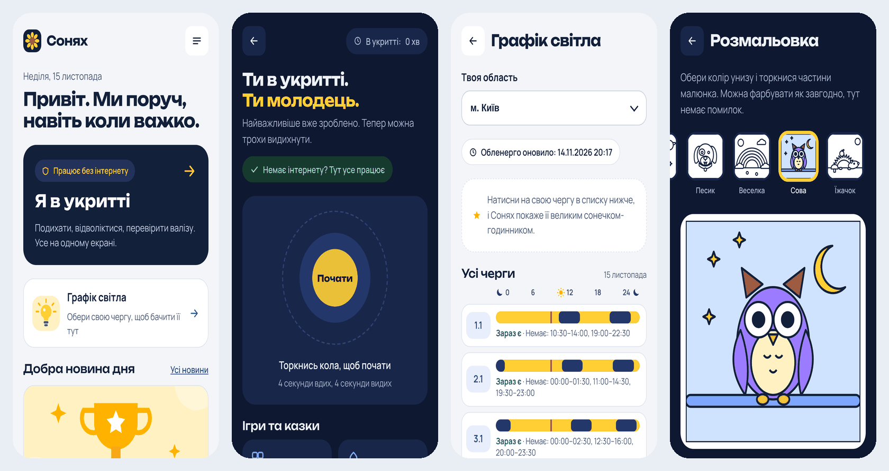

# Sonyakh 🌻

**A free offline-first PWA that helps people in Ukraine get through air-raid alerts and power outages.**

**Live:** [sonyakh.pp.ua](https://sonyakh.pp.ua) · **Telegram:** [@sonyakh56](https://t.me/sonyakh56) · [Інструкція українською](docs/README.uk.md)



## What it does

- **Shelter mode** works with no connection: a guided breathing exercise, calming games for kids (memory, bubbles, spot the difference), 10 coloring pages and 10 bedtime stories, an emergency bag checklist and first-aid tips.
- **Power outage schedules** for 11 regions, collected automatically from regional grid operators every 15 minutes. People see whether their queue has power right now, the next outage and the whole day on a 24-hour "sunflower clock".
- **Good news feed**, filtered hourly from five Ukrainian media RSS feeds and cross-posted to a Telegram channel.
- **Wall of thanks** and parenting tips sent by users, moderated before they are published.
- **"What's new" page and update banner**, so people know the installed app has been improved.

It installs to the home screen like a native app, works without the internet, and has no ads, no sign-up and no tracking cookies.

## Architecture

```
GitHub Actions (cron)                 GitHub Pages (static)                 Phone (PWA)
┌─────────────────────────┐   commit   ┌──────────────────────┐   fetch    ┌────────────────────────────┐
│ collect-outages  /15 min├──────────►│ data/outages.json     ├──────────►│ Service Worker cache        │
│ collect-news     hourly ├──────────►│ data/news.json        │           │  - app shell: cache-first   │
│ post-telegram    hourly │           │ index.html, app.js …  │           │  - data/*: network-first    │
└─────────────────────────┘           └──────────────────────┘           │ Vanilla JS SPA (hash router)│
                                                                           └──────────────┬─────────────┘
                                       Supabase (Postgres + RLS)  ◄── Edge Function ◄─────┘ user posts
                                       thanks / tips / suggestions     (Cloudflare Turnstile check)
```

- **No framework, no build step.** A single-page app in plain JavaScript, HTML and CSS: hash routing, rendering from template strings, a tiny store over `localStorage`.
- **Offline-first.** A Service Worker precaches the app shell and fonts and serves data network-first with a cached fallback. App updates install silently, are applied when the app goes to the background, and are announced by a banner with a changelog.
- **Zero-cost backend.** Scheduled GitHub Actions act as the backend: they scrape, normalize and commit JSON data, which GitHub Pages then serves as a static API.
- **Outage scrapers** (`scripts/collect-outages.mjs`): one parser per grid operator (embedded JSON in HTML, REST APIs, HTML tables, a windows-1251 legacy site). Each produces one normalized format of intervals per queue. A failed source keeps the last good data and is marked stale instead of being wiped. Sites protected against bots are never bypassed.
- **News pipeline** (`scripts/collect-news.mjs`): RSS → keyword scoring with weighted positive terms, a blocklist and URL-section filters → de-duplication of the same event → JSON. If an `ANTHROPIC_API_KEY` is set, it switches to selecting and rewriting stories with the Claude API, using structured output.
- **User content** goes through a Supabase Edge Function (Deno) that verifies Cloudflare Turnstile. Postgres row-level security and rate limits keep unapproved posts private.
- **Security and privacy:** a strict Content-Security-Policy, self-hosted fonts, cookie-free analytics (GoatCounter), no secrets in the repository (all keys live in GitHub and Supabase secrets).
- **Accessibility:** semantic buttons, ARIA labels, `prefers-reduced-motion` support and large touch targets for people under stress.

## Tech stack

JavaScript (ES2022) · HTML · CSS · Service Worker / PWA · Node.js 22 · GitHub Actions · GitHub Pages · Supabase (PostgreSQL, RLS, Edge Functions / Deno, TypeScript) · Cloudflare Turnstile · Telegram Bot API · Claude API (optional)

## Run locally

```bash
python -m http.server 8321      # then open http://localhost:8321
npm ci
node scripts/collect-outages.mjs    # refresh power outage schedules
node scripts/collect-news.mjs --dry # preview the news the robot would pick
```

## Author

Built by **Mykola Tsivka**. Feedback and ideas are welcome via the [Telegram channel](https://t.me/sonyakh56).
